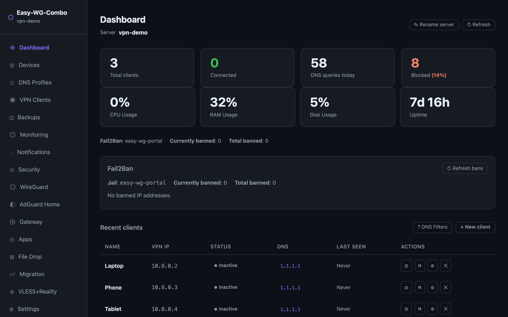
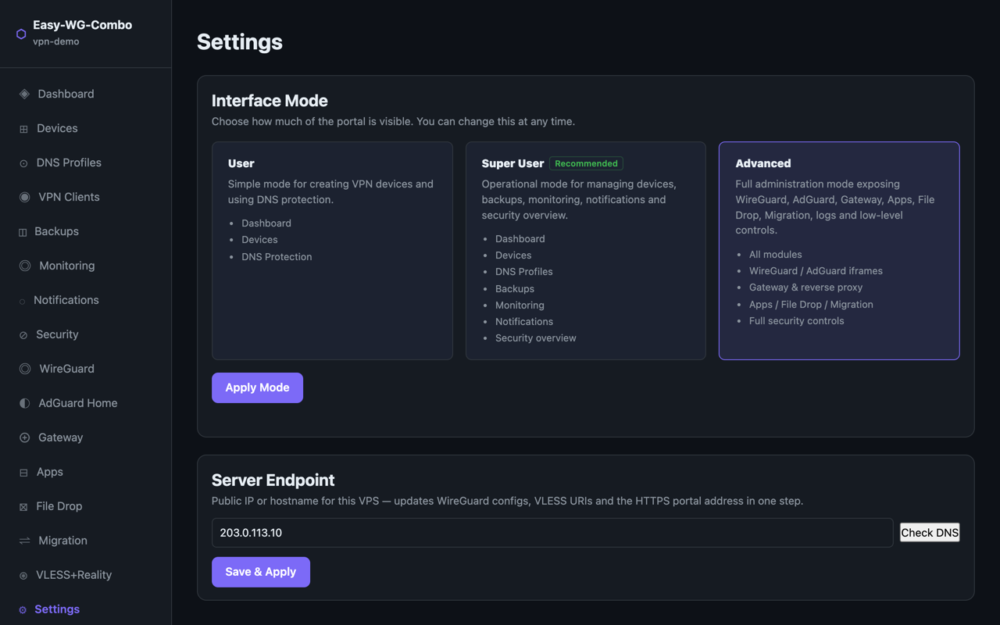
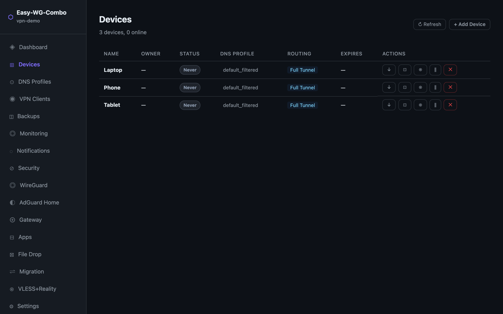
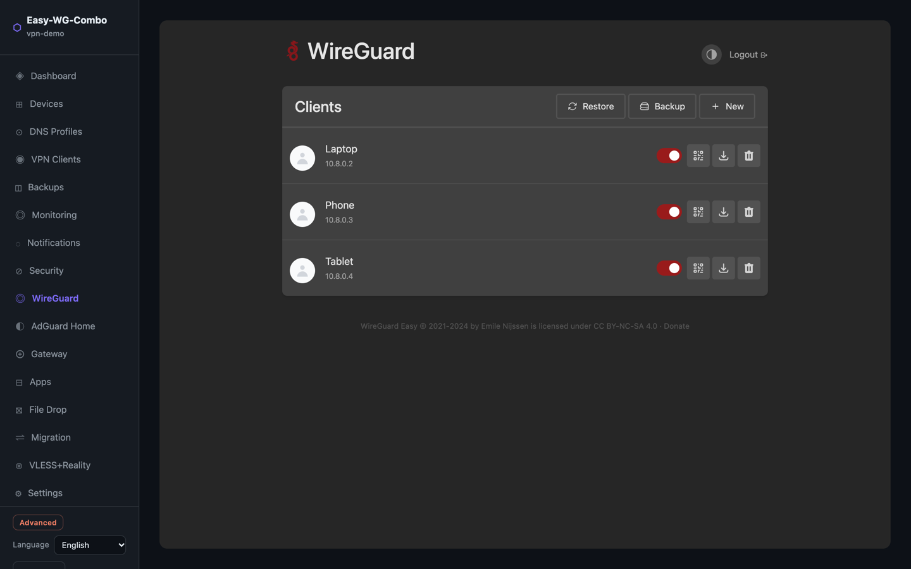
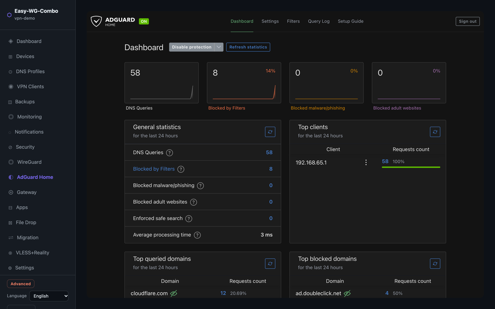

# Easy-WG-Combo

[](https://github.com/r45635/Easy-WG-Combo/actions/workflows/ci.yml)
[](LICENSE)

Easy-WG-Combo turns a small VPS into a personal VPN, DNS protection, security and monitoring appliance.

It combines WireGuard, AdGuard Home, a custom admin portal, HTTPS access, security checks, backups, notifications and optional advanced gateway features — without requiring users to manually assemble and maintain many separate tools.

---

## What It Does

- **WireGuard VPN** — create and manage devices, generate QR codes, share configs
- **VLESS+Reality** — optional DPI-resistant tunnel (Xray); per-device QR codes; for censored networks
- **AdGuard Home DNS** — block ads and malware per device; switch presets without reconnecting
- **Security Center** — Fail2Ban monitoring, UFW status, TLS certificate, session management, security score
- **Backups** — local backup and restore with a guided workflow
- **Monitoring** — HTTP, HTTPS, TCP, DNS, Docker and TLS checks with alerts
- **Notifications** — email and webhook alerts for monitor events
- **Update & drift check** — tells you when a newer release exists, and when your Caddyfile has stopped serving the security headers
- **Mobile-friendly** — responsive UI with hamburger sidebar for smartphone access
- **Multilingual** — English, French, Chinese

Optional advanced features: reverse proxy/gateway, app launcher, secure file drop, migration assistant.

---

## Who It Is For

Easy-WG-Combo is designed for:
- Personal VPS users who want a VPN without manual WireGuard configuration
- Homelab users managing a small set of devices
- Families who want simple DNS-based ad and malware blocking
- Small teams needing basic private remote access

It is not intended to replace enterprise VPN gateways, zero-trust platforms or managed security appliances.

---

## Feature Status

Core features (WireGuard devices, AdGuard DNS filtering, mobile UI) are **stable**. Security Center, backups, notifications, monitoring, DNS profiles and the Xray VLESS+Reality tunnel are **beta**. Gateway is **experimental**; Apps, File Drop and Migration Assistant are **previews** and not production-ready.

→ [Detailed feature status](docs/feature-status.md) *(canonical per-feature table)*

---

## Interface Modes

The portal has three modes so users are not exposed to unnecessary complexity: **User** (essentials only), **Super User** *(default — adds DNS profiles, backups, monitoring, security overview)* and **Advanced** (everything, including embedded WireGuard/AdGuard views and preview features). Switch from the **Settings** tab at any time.

→ [Interface modes reference](docs/interface-modes.md) *(canonical mode-by-mode table)*

---

## Screenshots





<details>
<summary>More screenshots</summary>

**VPN Clients**


**WireGuard & AdGuard embedded views**


</details>

---

## Quick Install

Requires a fresh Debian 12/13 or Ubuntu 24.04+ VPS — 1 vCPU and 1 GB RAM is enough.

```bash
export WG_HOST=YOUR_VPS_IP ADMIN_PASSWORD='choose-a-strong-password'
curl -fsSL https://raw.githubusercontent.com/r45635/Easy-WG-Combo/refs/heads/main/install.sh | bash
```

> Pick a strong `ADMIN_PASSWORD`: at least 12 characters (16+ recommended), and **no `$`** (Docker Compose interprets it in `.env`).

The installer installs Docker, UFW and Fail2Ban on the host, then configures and starts the containers (wg-easy, AdGuard Home, the portal and Caddy). The admin portal is **local-only by default** (reached via SSH tunnel); public HTTPS is opt-in.

**Two ways in:**
- 🚀 **I just want my own VPN** → the **[beginner guide](docs/setup.md)** takes you from an empty VPS to a working VPN in ~15 minutes (no Linux knowledge needed).
- 🔧 **I want to understand/control everything** → **[advanced install & reference](docs/advanced-install.md)** (options, env vars, manual install) + [security model](docs/security-model.md), [gateway](docs/gateway.md), [Xray](docs/xray.md), [monitoring](docs/monitoring.md).

### Updating

```bash
cd ~/Easy-WG-Combo
./easywg update
```

This pulls the latest code, then **pulls the portal image CI built for that exact commit** rather than compiling it on your server — which matters on a 1 vCPU / 1 GB VPS. It refreshes the other pinned images and runs a health check. If no image exists for the commit (local commits, a fork, CI still running) it says so and builds instead.

It refuses to run on a checkout with local edits. If you need a permanent local change, put it in `docker-compose.override.yml` rather than editing `docker-compose.yml` — see [local customisations](docs/advanced-install.md#local-customisations--docker-composeoverrideyml). Version history is in [CHANGELOG.md](CHANGELOG.md).

> **Note:** WireGuard is deliberately pinned to wg-easy **v14** — v15 is a breaking rewrite with an incompatible data model. `easywg update` will never cross that major version.

---

## Admin Exposure Modes

Easy-WG-Combo supports two admin exposure modes.

### Local-only mode *(safest)*

The portal, wg-easy and AdGuard Home are bound to localhost and reachable only through an SSH tunnel.

```bash
ssh -i ~/.ssh/your_key -L 19080:localhost:8080 -N root@YOUR_VPS_IP
# Then open: http://localhost:19080
# If you changed the SSH port, add -p <port>:  ssh -p 2222 -L 19080:localhost:8080 -N root@YOUR_VPS_IP
```

### Public HTTPS mode

The portal can be served over HTTPS through Caddy by setting `PUBLIC_HTTPS_ENABLED=yes` in `.env`.

Serving it is not the same as opening it to the internet. Since 0.6.5 the admin port is **never** opened to Anywhere by the installer. What reaches it:

| Who | How |
|---|---|
| You, on the VPN | Nothing to do — wg-easy puts VPN clients on the Docker bridge, which is allowed |
| You, over SSH | `ssh -L 8443:127.0.0.1:8443 -N root@YOUR_VPS_IP` |
| A fixed address (home, office) | `ADMIN_ALLOW_FROM=203.0.113.9 198.51.100.0/24` in `.env`, then re-run bootstrap or `./easywg admin lock` |
| You, from somewhere else, once | `./easywg admin open --from-ssh --for 30m` — the rule removes itself |

```bash
./easywg admin status    # who can reach the portal right now
./easywg admin open --from-ssh --for 30m
./easywg admin close     # or just wait
./easywg admin lock      # apply the default on an older install
```

Upgrading an install made before 0.6.5? It still carries an `allow 8443/tcp` (Anywhere) rule. `./easywg admin lock` converts it, and `./easywg doctor` fails until it is gone.

→ [Security model](docs/security-model.md)

---

## Basic Usage

### Create a VPN device

Open **Devices** → **+ New device** → choose a DNS preset → share the QR code or `.conf` file.

Install a WireGuard client app on the device to scan the QR code. → [Client apps](docs/clients.md)

### Change DNS protection

In **Devices**, click the settings icon on any device to change its DNS preset instantly — no reconnection needed.

Or in **DNS Profiles** (Super User / Advanced), create named profiles and assign them per device.

### Create a backup

Open **Backups** → **Create backup**. Encrypted backups require the `age` tool.

### Check monitoring

Open **Monitoring** to see the status of all configured checks. Alerts are sent via the Notifications channel.

---

## Advanced Features

### VLESS+Reality (Xray)

An optional DPI-resistant tunnel that runs alongside WireGuard. Designed for censored networks where WireGuard is blocked.

- Enable with `XRAY_ENABLED=yes` in `.env`, then re-run `./bootstrap.sh`
- Each device gets its own VLESS UUID — tap **⊛** in the Devices tab to get a QR code
- Revoking a device also revokes its VLESS access
- Available from **Super User** mode (not Advanced-only)

→ [Xray documentation](docs/xray.md)

---

The following features are available in **Advanced** mode. Gateway is experimental; Apps, File Drop and Migration are preview features — not recommended for production.

### Gateway / Reverse Proxy

Manage Caddy services that expose local or VPN services via domain name — VPN-only or publicly.

→ [Gateway documentation](docs/gateway.md)

### Apps

A small curated catalog of optional self-hosted apps manageable through the portal. Install/manage operations require a writable Docker socket.

> Apps are a preview feature. Do not use for critical workloads.

### File Drop

Drag-and-drop file sharing with expiry dates, password protection and token-gated public links.

> File Drop is a preview feature. Public links should use passwords and expiry limits.

### Migration Assistant

A checklist and helper for planning migrations. Full VPS-to-VPS migration is not yet implemented.

> Migration is a preview feature.

---

## CLI

All features are available from the terminal:

```bash
./easywg status                    # System health summary
./easywg doctor                    # Check installation health
./easywg passwd                    # Rotate the admin password everywhere
./easywg backup                    # Create a backup
./easywg restore <file>            # Restore from backup

./easywg device list               # List devices
./easywg dns profiles              # List DNS profiles
./easywg monitor list              # List uptime monitors
./easywg monitor check <id>        # Run a check immediately

./easywg proxy list                # List reverse proxy services
./easywg app catalog               # List available apps (preview)

./easywg xray status               # Xray service status
./easywg xray client-uri [label]   # Print VLESS URI (global)
./easywg xray restart              # Restart Xray container
./easywg xray rotate-keys          # Rotate the Reality key pair (needs --confirm;
                                   # invalidates every client config)

./easywg admin status              # Who can reach the admin portal right now
./easywg admin open --from-ssh     # Open it for this SSH session's IP, for 30 min
./easywg admin close               # Close it now
./easywg admin lock                # Apply the default (VPN + ADMIN_ALLOW_FROM only)
```

Run `./easywg help` for the full command list.

---

## Security Notes

- The portal is a **root-equivalent** local admin component (it controls Docker, the firewall and certificates). Treat access to it accordingly — compromise of the portal is compromise of the host.
- The admin portal is **local-only by default** (reachable via SSH tunnel / VPN). Public HTTPS is opt-in (`PUBLIC_HTTPS_ENABLED=yes` or the install prompt), and even then the admin port is never opened to Anywhere: VPN clients and `ADMIN_ALLOW_FROM` only, plus `./easywg admin open` for a one-off. `doctor` and the Security Center both fail on an "Anywhere" rule. Admin passwords must be at least 12 characters (16+ recommended) and must not contain `$`.
- Rotate the admin password with `./easywg passwd` — it updates the portal, the wg-easy hash and `.env` together (the in-portal password change only affects the portal login).
- See [SECURITY.md](SECURITY.md) for the accepted-risk model.
- The Docker socket, even read-only, is sensitive. The Apps module requires a writable socket.
- Gateway can expose services publicly. Review each service before enabling public access.
- File Drop public links are accessible without VPN. Use passwords and expiry.
- Backups may contain secrets (WireGuard keys, API tokens, the Xray private key). Store them securely. If one may have leaked, `./easywg xray rotate-keys` replaces the Reality key pair — it tells you how many devices must then be re-provisioned before it does anything.
- **Each installation serves its own icons.** Shodan, FOFA and Censys index a favicon by hashing it, so one query lists every host serving the same file — and the defaults ship in this public repository, which makes the file in git the fingerprint. At first start the portal derives its own `favicon.ico`, `favicon.svg` and `apple-touch-icon.png` into `portal/data/brand/`: visually identical, different bytes, different hash. They are kept across updates (a hash that moved on every update would be pointless), they are included in backups, and if generation ever fails the icons answer **404** rather than falling back to the shared default. `./easywg doctor` verifies what the server actually serves. Note that the page title and the exact security-header set remain searchable fingerprints of their own.
- The dashboard checks GitHub once every 6 hours for a newer release. It sends nothing but the request itself. Set `UPDATE_CHECK_ENABLED=no` in `.env` to disable it.

→ [Full security model](docs/security-model.md)

---

## Documentation

| Document | Contents |
|---|---|
| [Beginner guide](docs/setup.md) | Zero-to-VPN walkthrough — VPS → SSH → install → portal → phone → verify |
| [Advanced install & reference](docs/advanced-install.md) | Install options, manual install, env variables, exposure, Fail2Ban, firewall, architecture |
| [Client apps](docs/clients.md) | WireGuard and VLESS+Reality apps for Android, iOS, macOS, Windows, Linux |
| [Interface modes](docs/interface-modes.md) | User / Super User / Advanced breakdown |
| [Feature status](docs/feature-status.md) | Detailed status for all features |
| [Xray VLESS+Reality](docs/xray.md) | DPI-resistant tunnel — setup, per-device QR, client apps |
| [Experimental features](docs/experimental-features.md) | Gateway, Apps, File Drop, Migration — what works and what doesn't |
| [Apps preview](docs/apps-preview.md) | Optional self-hosted app catalog — setup and limitations |
| [File Drop preview](docs/filedrop-preview.md) | File sharing — setup, tokens, limitations |
| [Migration preview](docs/migration-preview.md) | Migration checklist/helper — current scope |
| [Security model](docs/security-model.md) | Threat model, exposure modes, sensitive operations |
| [Gateway](docs/gateway.md) | Reverse proxy / Caddy services |
| [Monitoring](docs/monitoring.md) | Uptime check types, CLI, auto-seeded defaults |
| [Troubleshooting](docs/troubleshooting.md) | Common issues and fixes |

---

## Known Limitations

- Single admin user only (no multi-user support)
- WireGuard pinned to wg-easy v14 — v15 is a breaking rewrite with an incompatible data model
- Apps and File Drop require additional VPS setup and are not production-ready
- Full VPS-to-VPS migration is not yet implemented
- `adguard`, `portal` and `caddy` use `network_mode: host` (AdGuard needs port 53 on the host; Caddy needs 80/443)

---

## License

MIT — see [LICENSE](LICENSE).
